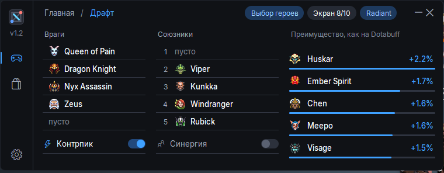

# Draft Helper — подсказчик героев для Dota 2

Окно поверх игры. На драфте оно показывает пять лучших героев для выбора и объясняет, почему именно их, а в игре — билд на твоего героя.

### [⬇ Скачать Draft Helper.exe](https://github.com/zurcsed/dota-draft-stats/releases/latest/download/Draft.Helper.exe)

Windows, один файл, установка не нужна. Что нового — на странице [релизов](https://github.com/zurcsed/dota-draft-stats/releases).

## Что умеет

- **Драфт.** Сам видит выбранных героев на экране и считает, кто лучше всего играет против врагов (преимущество, как на Dotabuff) и с напарником по линии.
- **Баны.** Читает забаненных героев с сетки выбора и отмечает их в подсказках (экран 1920×1080).
- **Билд в игре.** Нетворс и цель для твоего ранга, предметы сильных игроков к текущей минуте, раскачка, таланты и начальный закуп.
- **Не мешает игре.** Окно не забирает клавиатуру; показать и спрятать его — горячая клавиша (по умолчанию Insert).

## Как начать

1. Скачай и запусти `Draft Helper.exe`.
2. Программа предложит подключиться к Dota 2 — согласись и перезапусти игру.
3. В настройках Dota 2 включи режим «Окно без рамки», иначе подсказчика не будет видно поверх игры.
4. Зайди в игру: на драфте окно само покажет подсказки. Если героя не удалось распознать, его можно выбрать вручную.

Новая версия ставится так же: замени старый файл новым.

## Безопасность

Программа использует только публичную статистику и официальную функцию Valve — Game State Integration. Память игры она не читает и в игру ничего не встраивает.

Раз в сутки, когда запущена Dota 2, программа сообщает нашему серверу случайный номер установки и свою версию — только чтобы знать, сколько человек ей пользуется. Больше ничего не отправляется, IP-адреса не сохраняются (`launch_count.py`).

## Откуда статистика

- **Драфт** — STRATZ API (рейтинговые матчи всех рангов, 4 завершённые недели и текущая), винрейты и контрпики — по публичным матчам Valve за 14 дней, которые собирает наш сервер.
- **Билд** — предметы, нетворс и таланты сильных игроков из STRATZ; раскачка, таланты и начальный закуп из Dota Pro Tracker. Наш сервер забирает их раз в неделю ночью, а программа скачивает копию отсюда и к сайту сама не обращается.

**Данные: [Dota Pro Tracker](https://dota2protracker.com/)** — раскачка, таланты и начальный закуп, по договорённости с сайтом.

Статистика пересобирается каждые 6 часов и лежит на GitHub Pages; свой ключ STRATZ не нужен.

<b>Для разработчика: что лежит в репозитории</b>

| Файл | Назначение |
| --- | --- |
| `build_feed.py` | собирает `stats.json`, `builds.json` и `protracker.json` для GitHub Pages |
| `data.py`, `stratz.py`, `paths.py` | загрузка и разбор статистики (общие с программой) |
| `builds.py`, `protracker.py` | билды из STRATZ и из Dota Pro Tracker |
| `valve_collect.py`, `valve_export.py`, `valve_stats.py` | сбор матчей Valve и расчёт статистики |
| `launch_count.py` | счётчик: номер установки и версия раз в сутки при запущенной Dota, без IP |
| `server/` | установка сборщика на сервер (Ubuntu, systemd) |
| `.github/workflows/feed.yml` | сборка и публикация статистики |
| `Draft Helper.exe` | копия последней версии для старых ссылок |

Исходный код самой программы (окно, распознавание экрана) здесь не лежит, только её сборка.

Настройка:
- секрет репозитория `STRATZ_TOKEN` — токен STRATZ API (stratz.com/api);
- переменная `VALVE_STATS_URL` — адрес `valve_stats.json` на сервере сбора (пусто — числа STRATZ);
- Settings → Pages → Source: «GitHub Actions»; ручной запуск: Actions → «Update hero stats» → «Run workflow»;
- сервер: `bash server/setup.sh` от root, ключ Steam Web API — в `/etc/dota-collector.env`.

---

## English

Draft Helper is an overlay for Dota 2. During the draft it shows the top-5 heroes to pick and explains each one (advantage against the enemy picks, lane partner synergy); in the game it shows a build for your hero.

**[⬇ Download Draft Helper.exe](https://github.com/zurcsed/dota-draft-stats/releases/latest/download/Draft.Helper.exe)** — Windows, single file, no installation. Turn on "Borderless window" in Dota 2.

Only public statistics and Valve's official Game State Integration are used; game memory is never read. Once a day, while Dota 2 is running, the app sends our server a random install number and its version to count users; nothing else is sent and IP addresses are not stored.

**Data: [Dota Pro Tracker](https://dota2protracker.com/)** — skill orders, talents and starting items, used by agreement with the site.

Statistics: STRATZ API and public Valve matches collected by our server, rebuilt every 6 hours on GitHub Pages.

## License

[MIT](LICENSE)
